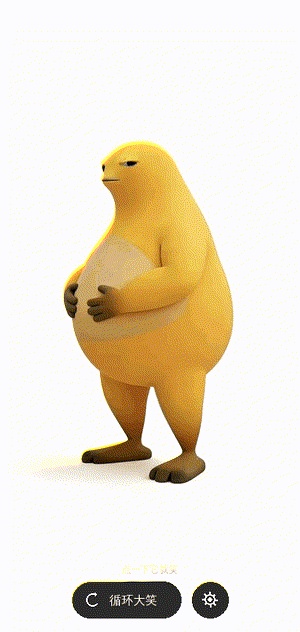

# 哈哈哈 LaughBox

一个安卓恶搞小应用：打开是一坩胖乎乎的黄色卡通角色站着，**点一下它就狂笑**。

<p align="center">
  
</p>

- **点任意位置** → 角色拍着肚子大笑，笑完自己回待机
- **🔄 循环大笑** → 开了就再也停不下来
- **⚙ 设置** → 笑声音量、笑到震动
- 连点会显示「哈哈哈哈哈 ×N」

整个安装包 **1.1 MB**，全程离线，不联网、不收集任何数据。

---

## 快速开始

### 只想装

把 `laughbox.apk` 传到手机点安装即可（需允许"安装未知来源应用"）。

### 想自己构建

项目**刻意不使用 Gradle** —— 它只有一个 Activity，构建链极短，
直接调 `aapt2` / `javac` / `d8` / `zipalign` / `apksigner` 更快，
也省掉几百 MB 的 Gradle 依赖。

```bash
# 需要 JDK 17+ 与 Android SDK（platform-34 / build-tools 34.0.0）
BT=/path/to/toolchains ./build.sh
```

`BT` 目录下需要有：

```
$BT/<jdk>/                                    # JDK 17+，目录名任意
$BT/android-sdk/platforms/android-34/android.jar
$BT/android-sdk/build-tools/34.0.0/            # aapt2 d8 zipalign apksigner
```

产物在 `dist/laughbox.apk`（自动用 debug keystore 签名）。

若 `ANDROID_HOME` 或 `ANDROID_SDK_ROOT` 已设置，可省略 `BT`。

---

## 技术要点

| 项 | 做法 |
|---|---|
| 最低版本 | Android 5.0 (API 21)，targetSdk 34 |
| 待机画面 | 一张静态 PNG + `ObjectAnimator` 呼吸缩放 |
| 大笑动画 | `MediaPlayer` + `TextureView` 播放内嵌 mp4（含原声笑声） |
| 画面显隐 | **用 `alpha` 而非 `setVisibility`**（见下方踩坑） |
| 资源完整性 | 构建期生成 `AssetSize.java`，运行时精确校验缓存字节数 |

### 三个真实踩过的坑

**1. TextureView 的 SurfaceTexture 死锁**

最初用 `video.setVisibility(GONE)` 隐藏播放层，结果冷启动后**点哪里都没反应**。

原因：TextureView 的 SurfaceTexture **只在 View 可见并被绘制时才创建**。
于是形成闭环 —— 要显示才解锁，要解锁才显示。`ViewGroup.dispatchDraw`
只跳过 `visibility != VISIBLE` 的子 View，**alpha 不参与判断**，
所以改成 `setAlpha(0f / 0.99f)` 控制显隐即可。

**2. 手工打包时 dex 的路径**

`zip` 很容易把 dex 存成 `dex/classes.dex`，而 ART 只认根目录的 `classes.dex`，
症状是装上一点就崩。用 `zip -j`（junk paths）解决。

**3. 资源截断导致永久失效**

首次启动要把 mp4 从 assets 拷进缓存。写到一半被打断会留下一个"看起来存在"
的残缺文件，之后永远不再重新拷贝 —— app 就此哑掉。

解法：临时文件 + 原子 `rename`，运行时用构建期注入的精确字节数校验；
一旦解码失败，**区分"缓存坏了"和"设备解不了码"**，前者重装后者熔断，
否则会陷入"删除→重拷→再失败"的死循环。

---

## 目录结构

```
.
├── app/
│   ├── AndroidManifest.xml
│   ├── assets/laugh.mp4          # 大笑动画 + 原声笑声
│   ├── res/
│   │   ├── drawable-nodpi/       # 待机图（不随密度缩放）
│   │   ├── drawable/             # 胶囊按钮、设置面板等 shape
│   │   ├── layout/
│   │   ├── mipmap-*/             # 各密度图标
│   │   └── values/
│   └── src/com/lazy/laughbox/MainActivity.java
├── tools/
│   ├── extract_assets.py         # 从录屏提取待机图与大笑片段
│   └── make_icons.py             # 抠像 + 生成各密度图标
├── build.sh
└── LICENSE
```

---

## ⚠️ 素材声明

`app/assets/laugh.mp4` 与 `app/res/drawable-nodpi/hero_idle.png` 中的角色形象
来自某个 iOS 恶搞 App 的**手机录屏**，著作权不属于本项目作者。
MIT 许可仅覆盖源代码，不覆盖这两个文件。本仓库仅用于技术演示。

换素材请自行替换这两个文件（注意保持 **4:7 比例**与 **720×1260** 分辨率，
否则播放时会跳变），详见 `tools/extract_assets.py`。

---

## License

源代码 MIT，见 [LICENSE](LICENSE)。素材例外见上方声明。
